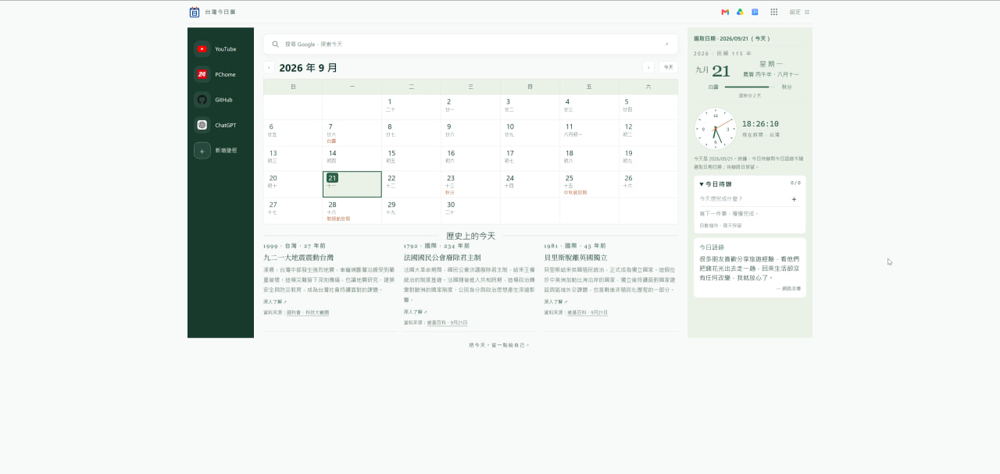

# Taiwan Today

[繁體中文](README.md) · **English**

Taiwan Today is a Chrome new tab extension that brings the Taiwanese calendar, weather, to-dos, and website shortcuts together. The calendar and built-in content are available offline.

[Website](https://today.stack-base.com/) · [Chrome Web Store](https://chromewebstore.google.com/detail/adgohcafbfdmkkllmphehaeainhbeigp) · [Latest release](https://github.com/bruce-yang-422/Taiwan-Today/releases/latest)



## Features

- Gregorian and lunar dates, solar terms, Taiwanese holidays, and international observances, with travel and overseas time zone settings.
- On This Day and daily quotes, plus personal history imports from CSV, Excel, ODS, or JSON. [Download templates](templates/README.md)
- Clock, weather, to-do list, web search, and customizable website shortcuts.
- Five layouts, light and dark themes, and a Traditional Chinese, English, or Japanese interface.

## Installation

Install from the [Chrome Web Store](https://chromewebstore.google.com/detail/adgohcafbfdmkkllmphehaeainhbeigp), then open a new tab.

For manual installation, download and extract the extension ZIP from the [latest release](https://github.com/bruce-yang-422/Taiwan-Today/releases/latest). Enable Developer mode in `chrome://extensions` or `edge://extensions`, choose **Load unpacked**, and select the folder containing `manifest.json`.

## Usage

Open a new tab and use **Settings** in the upper-right corner to change the layout, language, and visible widgets. In the **Monthly Journal** layout, select a date on the monthly calendar to see its calendar details and historical events.

Travel mode keeps the Taiwanese calendar and lets you show Taiwan time or the time zone of your weather location. For longer stays abroad, use international mode to set the calendar and clock to your device’s time zone or a time zone you choose. Set the weather location separately by selecting a city and district in Taiwan or entering coordinates manually.

To add birthdays or family milestones to **On This Day**, fill out a [history template](templates/README.md) and select the file under **Settings → Data → Import personal events**. Review the preview before importing. The import replaces your current personal history. You can export a backup from the same screen before switching devices.

## Data and privacy

Settings, to-dos, shortcuts, and personal history are stored on the current device. Open-Meteo supplies weather data. You can authorize public data updates from GitHub in Settings. See the [privacy policy](https://today.stack-base.com/privacy.html) for details.

## Development

This project uses TypeScript, Vite, and Chrome Manifest V3. You’ll need Node.js 22.16 or later.

```sh
npm ci
npm run dev
```

Run `npm test` for unit tests. To test the extension in your browser, run `npm run build` and load the generated `dist/` folder as an unpacked extension. After building, run `npm run test:e2e` for the Playwright end-to-end tests.

## Support and license

[Report an issue](https://github.com/bruce-yang-422/Taiwan-Today/issues) · [Privacy policy](https://today.stack-base.com/privacy.html) · [ISC license](LICENSE.md)
