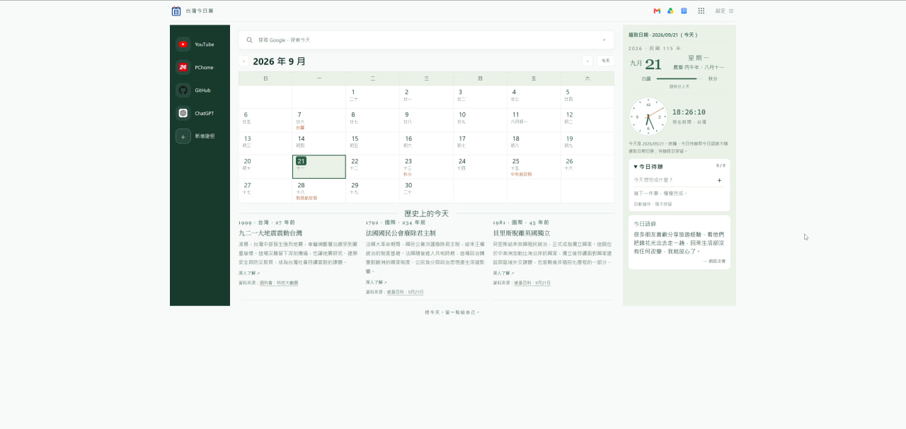

# 台灣今日曆 Taiwan Today

**繁體中文** · [English](README.en.md)

台灣今日曆是一款 Chrome 新分頁擴充功能，把臺灣日曆、天氣、待辦和常用網站放在同一頁。日曆與內建內容可離線使用。

[官方網站](https://today.stack-base.com/) · [Chrome 線上應用程式商店](https://chromewebstore.google.com/detail/adgohcafbfdmkkllmphehaeainhbeigp) · [最新版](https://github.com/bruce-yang-422/Taiwan-Today/releases/latest)



## 功能

- 國曆、農曆、節氣、臺灣假期及國際節慶，支援旅行與海外時區設定。
- 歷史上的今天與每日一句，可從 CSV、Excel、ODS 或 JSON 匯入個人紀事。[下載範本](templates/README.md)
- 時鐘、天氣、待辦清單、搜尋與自訂網站捷徑。
- 五種版面、深淺色主題，以及繁體中文、英文和日文介面。

## 安裝

從 [Chrome 線上應用程式商店](https://chromewebstore.google.com/detail/adgohcafbfdmkkllmphehaeainhbeigp) 安裝，再開啟新分頁。

手動安裝時，從 [最新版發布頁](https://github.com/bruce-yang-422/Taiwan-Today/releases/latest) 下載並解壓縮安裝 ZIP。在 `chrome://extensions` 或 `edge://extensions` 啟用開發人員模式，選擇「載入未封裝項目」，再選取含有 `manifest.json` 的資料夾。

## 使用方式

開啟新分頁後，從右上角的「設定」切換版面、語言與顯示內容。需要查看其他日期時，可在「月序手帖」版面點選月曆上的日期，查看當天的日曆資訊與歷史紀事。

短期出差可保留臺灣日曆，並選擇顯示臺灣時間或天氣地點的時區。長期海外模式則可讓日曆與時鐘採用裝置時區或指定時區。天氣地點可獨立選擇臺灣縣市、鄉鎮市區，或手動輸入座標。

如果想在「歷史上的今天」加入生日或家族紀事，先填寫[紀事範本](templates/README.md)，再到「設定 → 資料管理 → 匯入個人歷史」選擇檔案。確認預覽後，匯入會取代目前的個人紀事。更換裝置前可從同一處匯出備份。

## 資料與隱私

設定、待辦、捷徑與個人紀事儲存在目前裝置。天氣由 Open-Meteo 提供，公共資料可在設定中授權從 GitHub 更新。完整說明見[隱私權政策](https://today.stack-base.com/privacy.html)。

## 本機開發

需要 Node.js 22.16 以上版本。本專案使用 TypeScript、Vite 與 Chrome Manifest V3。

```sh
npm ci
npm run dev
```

執行 `npm test` 進行單元測試。若要在瀏覽器中測試實際的擴充功能，執行 `npm run build`，再於擴充功能管理頁載入產生的 `dist/`。建置後也可執行 `npm run test:e2e` 進行 Playwright 端對端測試。

## 支援與授權

[問題回報](https://github.com/bruce-yang-422/Taiwan-Today/issues) · [隱私權政策](https://today.stack-base.com/privacy.html) · [ISC 授權](LICENSE.md)
